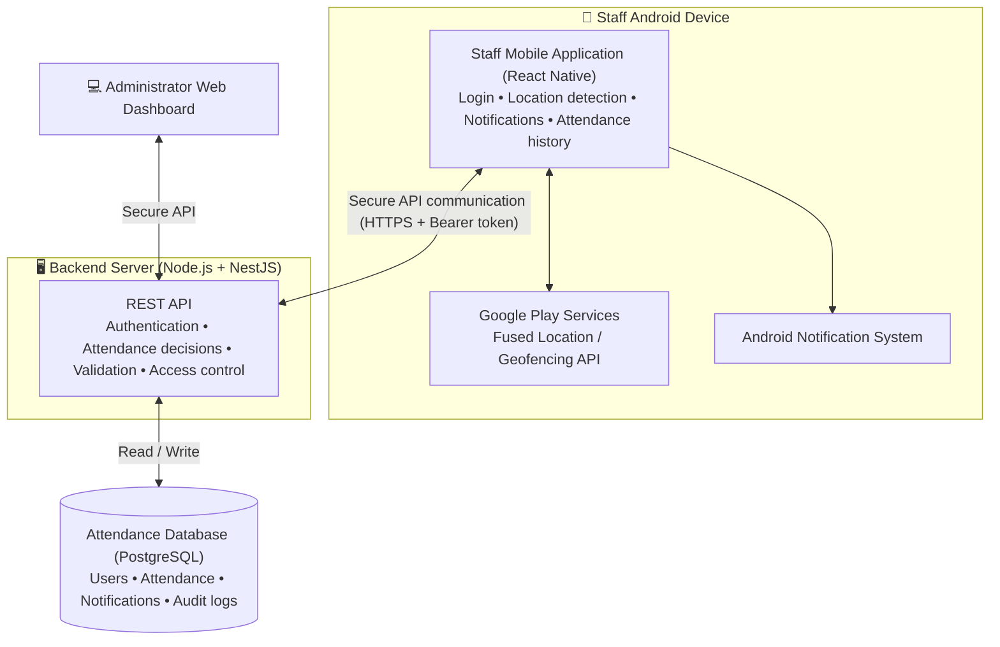
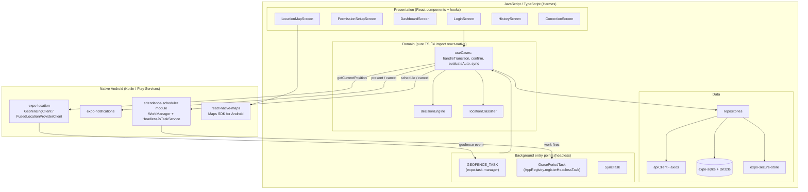
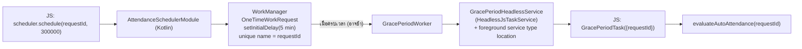
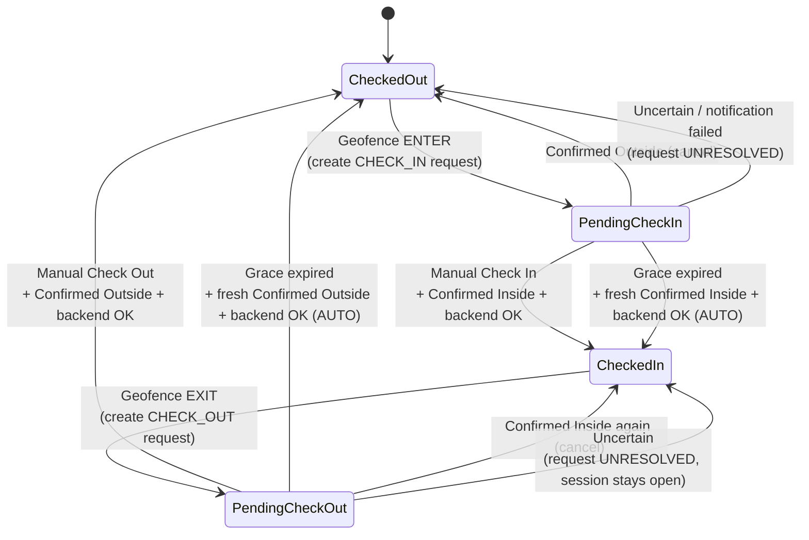
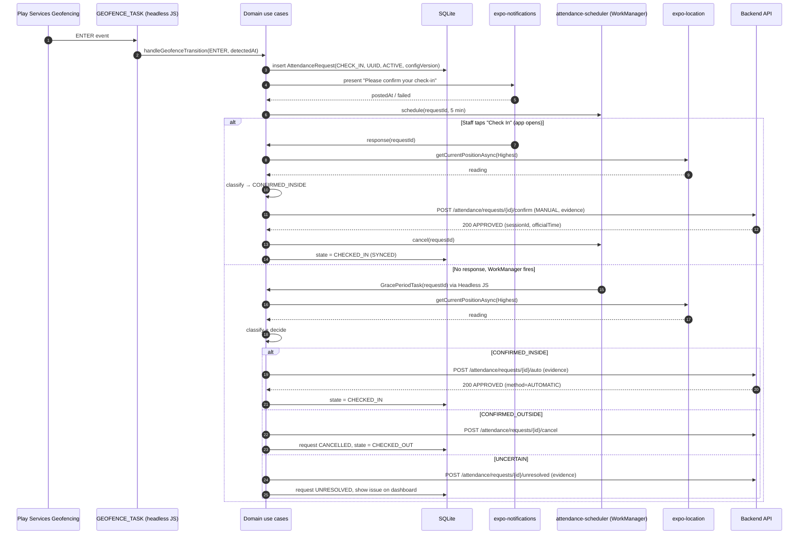
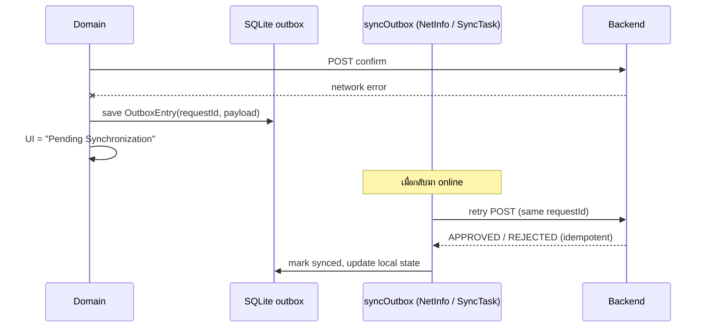
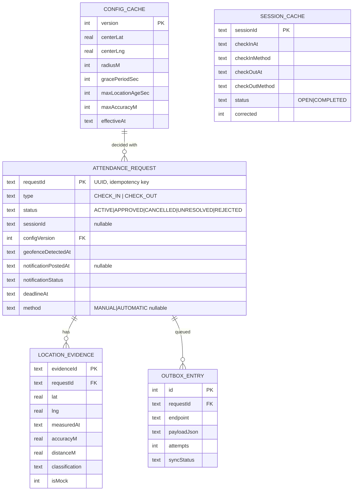
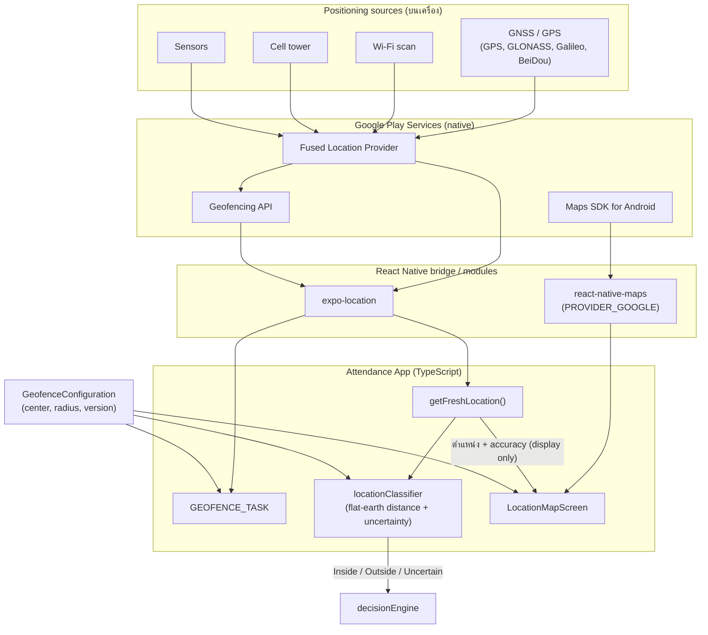
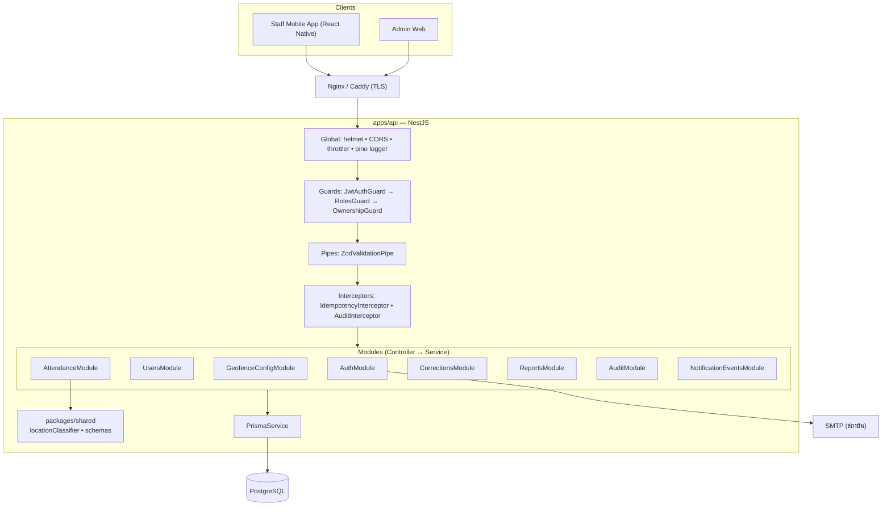
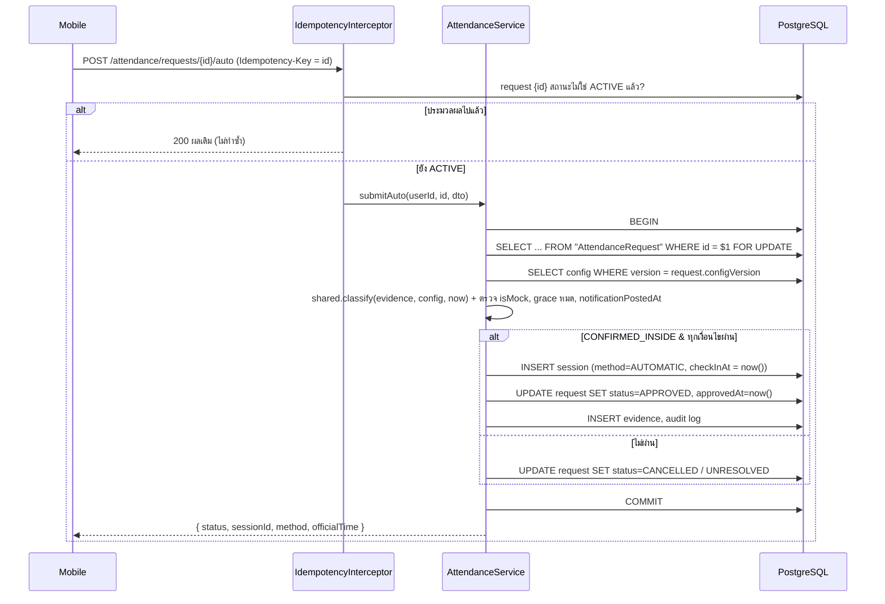

# Android Mobile Application Architecture (React Native)
## Software for Attendance Check for Staff Using Geofencing Technology

> **Senior Project BL1-2026** — SIIT, Thammasat University
> Thanyawach Keawhan · Nontapat Chaopratoom · Suleyman Hannyyev
> Advisors: Dr. Bing Gwong Leung, Dr. Somrudee Deepaisarn

**แหล่งข้อมูล (ลำดับความสำคัญ)**
1. Presentation slide — *Software for Attendance Check for Staff Using Geofencing Technology* (ใช้เป็นหลัก)
2. Design specification — *DS2_Improved* (ใช้ขยายรายละเอียดส่วนที่สไลด์ไม่ได้ระบุ)

เมื่อสองแหล่งขัดกัน เอกสารนี้ใช้ค่าจากสไลด์ และบันทึกค่าจาก DS2 ไว้ในตาราง [§13 Design Decisions & Open Issues](#13-design-decisions--open-issues)

**ข้อกำหนดจากทีม**: ใช้ **React Native** เป็น core application framework, target **Android OS**, map provider = **Google Maps Platform**, backend = **Node.js**

---

## สารบัญ
1. [ภาพรวมระบบ](#1-ภาพรวมระบบ)
2. [Requirements ที่ mobile app ต้องรองรับ](#2-requirements-ที่-mobile-app-ต้องรองรับ)
3. [System Context](#3-system-context)
4. [Technology Stack](#4-technology-stack)
5. [Layered Architecture (JS + Native)](#5-layered-architecture-js--native)
6. [Project Structure](#6-project-structure)
7. [Core Components](#7-core-components)
8. [Attendance State Machine & Decision Rules](#8-attendance-state-machine--decision-rules)
9. [Key Sequence Flows](#9-key-sequence-flows)
10. [Local Data Model & Sync](#10-local-data-model--sync)
11. [Backend API Contract](#11-backend-api-contract)
12. [Android Platform Concerns](#12-android-platform-concerns)
13. [Design Decisions & Open Issues](#13-design-decisions--open-issues)
14. [Testing Strategy](#14-testing-strategy)
15. [Implementation Roadmap](#15-implementation-roadmap)
16. [LBS, GPS & Map APIs](#16-lbs-gps--map-apis)
17. [Backend Architecture (Node.js)](#17-backend-architecture-nodejs)

---

## 1. ภาพรวมระบบ

Mobile app สำหรับบันทึกเวลาเข้า–ออกงานของอาจารย์และบุคลากรคณะ โดยใช้ **geofence** (วงกลมรอบตึกคณะ) ตรวจจับการเข้า/ออกพื้นที่ แล้ว:

1. **แจ้งเตือน** ให้ผู้ใช้กด Check In / Check Out ด้วยตนเอง (วิธีหลัก)
2. ถ้าไม่ตอบภายใน **grace period** → **ขอตำแหน่งใหม่ (revalidate)**
3. บันทึก **อัตโนมัติ** เฉพาะเมื่อตำแหน่งใหม่ยืนยันได้ว่ายังอยู่ใน (check-in) / ยังอยู่นอก (check-out) พื้นที่

**หลักการออกแบบสำคัญ**

| หลักการ | ความหมายต่อ architecture |
|---|---|
| Geofence transition ≠ attendance record | Transition เป็นแค่ *trigger* ให้สร้าง `AttendanceRequest` เท่านั้น |
| Backend is the source of truth | App ไม่แสดงว่า "บันทึกแล้ว" จนกว่า backend ยืนยัน; สถานะอื่นคือ *Pending Synchronization* |
| Location ≠ Attendance status | UI แยก "สถานะการลงเวลา" กับ "สถานะตำแหน่ง (Inside / Outside / Uncertain)" |
| Conservative automation | ตำแหน่ง Uncertain ห้ามอนุมัติ auto attendance ทุกกรณี |
| Idempotent requests | ทุก request มี UUID; ส่งซ้ำต้องได้ผลเดิม ไม่สร้าง record ซ้ำ |
| Privacy by design | เก็บเฉพาะ location evidence ที่ใช้ตัดสินใจ ไม่เก็บ travel history ต่อเนื่อง |
| One decision engine | Logic ตัดสินใจเขียนเป็น TypeScript ชุดเดียว ใช้ทั้งตอน foreground และใน background (Headless JS) |

---

## 2. Requirements ที่ mobile app ต้องรองรับ

### 2.1 Functional Requirements (จากสไลด์)

| ID | Requirement | ผู้รับผิดชอบหลัก |
|---|---|---|
| FR01 | User login and authentication | `features/auth` + backend |
| FR02 | Detect entry/exit of geofence | `services/location` (expo-location geofencing + background task) |
| FR03 | Send check-in/out notifications | `services/notifications` (expo-notifications) |
| FR04 | Support manual attendance confirmation | `features/attendance` |
| FR05 | Automatically check in/out after timeout and location validation | `domain/decisionEngine` + native `AttendanceScheduler` (WorkManager) + backend |
| FR06 | Store attendance records in database | backend DB (app เก็บ cache/outbox ใน SQLite) |
| FR07 | Display attendance history | `features/history` |
| FR08 | Provide administrator dashboard | **Admin Web** (อยู่นอก mobile app) |
| FR09 | Allow authorized attendance corrections | Staff ส่ง *correction request* จาก app; อนุมัติบน Admin Web |

### 2.2 User Roles

สไลด์กำหนด 3 roles; mobile app รองรับเฉพาะ **Staff Member** ส่วน role อื่นใช้ Admin Web

| Role | ช่องทาง | สิทธิ์ |
|---|---|---|
| Staff Member | **Android app** | Login, รับแจ้งเตือน, check in/out, ดูประวัติของตนเอง, ส่ง correction request |
| Attendance Administrator | Admin Web | ดู attendance ของ staff, แก้ไข record (ต้องมีเหตุผล), ออกรายงาน |
| System Administrator | Admin Web | จัดการ account, roles, geofence configuration, system settings |

> ถ้า account ที่ไม่ใช่ Staff login เข้า app → แสดงข้อความให้ใช้ Admin Web และไม่เริ่ม monitoring

### 2.3 Non-Functional Requirements (สไลด์ + DS2)

- **Security** — encrypted communication (HTTPS/TLS), token เก็บใน protected storage, ห้ามเชื่อ UI ในการคุมสิทธิ์ (backend enforce ทุก request)
- **Reliable background location detection** — ทำงานขณะ app ไม่อยู่บนจอ / จอล็อก / process ถูก kill
- **Privacy & access control** — staff เห็นเฉพาะข้อมูลของตนเอง
- **Consistent records** — ห้ามมี open session มากกว่า 1, ห้าม record ซ้ำ
- **Tolerance to location uncertainty and errors** — มีสถานะ Uncertain / Unresolved

### 2.4 Initial Configuration Parameters

| Parameter | ค่าเริ่มต้น | หมายเหตุ |
|---|---|---|
| Geofence radius | **150 m** (สไลด์) | configurable, ทดสอบภาคสนาม; DS2 เสนอ 200 m, สูงสุด 1,000 m |
| Grace period | 5 นาที | DS2 |
| Max location age | 60 วินาที | DS2 |
| Max horizontal uncertainty | 30 m | DS2 |
| Time zone | Asia/Bangkok | แสดงผล; เก็บเป็น UTC |
| Open session ต่อ user | ไม่เกิน 1 | ทำได้หลาย session ต่อวัน |

ค่าทั้งหมดดึงจาก backend (`GeofenceConfiguration` + `version`) ไม่ hard-code ใน app

---

## 3. System Context

ตาม slide *Proposed System Architecture — How the Components Connect*:



**ขอบเขตของเอกสารนี้**: กล่อง *Staff Mobile Application* เป็นหลัก, contract ที่ใช้คุยกับ Backend (§11) และโครงสร้าง Backend Node.js (§17)

---

## 4. Technology Stack

### 4.1 Core

| ด้าน | เลือกใช้ | เหตุผล |
|---|---|---|
| Framework | **React Native** (New Architecture: Fabric + TurboModules) | ข้อกำหนดของทีม; codebase เดียว ขยายไป iOS ได้ภายหลัง |
| Tooling | **Expo SDK** แบบ **Development Build / Prebuild** (ไม่ใช้ Expo Go) | ใช้ Expo modules ได้ และยังเขียน native code / config plugin เองได้ |
| Language | **TypeScript** (strict) | type-safe ระหว่าง domain, API DTO, DB |
| Android target | minSdk 26 (Android 8.0) / targetSdk ตาม Expo SDK ที่ใช้ | ต้องรองรับ background location (API 29+) และ `POST_NOTIFICATIONS` (API 33+) |
| Build & release | **EAS Build** (หรือ `npx expo run:android` + Gradle) | สร้าง APK/AAB, จัดการ keystore และ secrets |

### 4.2 Libraries

| ด้าน | Library | หน้าที่ |
|---|---|---|
| Navigation | **React Navigation** (native-stack, bottom-tabs) | Auth stack / Main stack |
| UI | React Native Paper (Material 3) | ตาม mockup (Login, Dashboard, History) |
| Server state | **TanStack Query** | cache history/state, retry, refetch on focus |
| Client state | **Zustand** | session, permission status, current location class |
| Forms & validation | react-hook-form + **zod** | login, correction form; zod ใช้ validate API response ด้วย |
| HTTP | axios + interceptors | แนบ token, refresh on 401, `Idempotency-Key` |
| Location & geofencing | **expo-location** | `getCurrentPositionAsync`, `startGeofencingAsync`, `hasServicesEnabledAsync` (ใช้ Fused Location / Geofencing ของ Play Services บน Android) |
| Background tasks | **expo-task-manager** | รับ geofence event ใน background (รัน JS แบบ headless) |
| Grace-period timer | **Custom native module `attendance-scheduler`** (Kotlin, Expo Modules API) ครอบ **WorkManager** + Headless JS | JS timer (`setTimeout`) ไม่รันเมื่อ app อยู่ background/ถูก kill (ดู §7.6) |
| Notifications | **expo-notifications** | channel, notification category พร้อมปุ่ม Check In / Dismiss |
| Secure storage | **expo-secure-store** (Android Keystore) | access/refresh token |
| Local DB | **expo-sqlite** + **Drizzle ORM** | outbox, pending request, cache; migration แบบ typed |
| Maps | **react-native-maps** (`PROVIDER_GOOGLE`) | แผนที่ geofence + ตำแหน่งผู้ใช้ (§16) |
| Network status | @react-native-community/netinfo | trigger sync เมื่อกลับมา online |
| Device info | expo-device, expo-application | ส่ง model/OS/app version ไปกับ evidence |
| UUID | expo-crypto (`randomUUID`) | idempotency key |
| Date/time | date-fns + date-fns-tz | แสดงผล Asia/Bangkok |
| Error/logging | Sentry (optional) + event log ใน SQLite | debug + ข้อมูลสำหรับ evaluation |

---

## 5. Layered Architecture (JS + Native)

React Native แบ่ง runtime เป็น **JS layer** (UI + business logic) และ **Native layer** (Android services) — งานที่ต้องรอดจาก process death ต้องอยู่ฝั่ง native แล้วเรียกกลับมา JS ผ่าน **Headless JS**



**กฎ dependency**
- `domain/` เป็น pure TypeScript → unit test ด้วย Jest ได้ทุก case ใน DS2 §3.6 โดยไม่ต้องใช้ device
- Background task ทุกตัวเรียก use case ชุดเดียวกับ UI — ไม่มี logic ซ้ำซ้อน
- UI ไม่เรียก expo-location / sqlite ตรง ผ่าน hooks + use cases เท่านั้น

---

## 6. Project Structure

Mobile, backend และ admin web อยู่ใน **monorepo เดียว** (pnpm workspaces + Turborepo) เพื่อแชร์ TypeScript types, zod schemas และ `locationClassifier` ระหว่าง app กับ server (ดู §17.2) — โครงสร้างด้านล่างคือ `apps/mobile`

```
attendance-app/   (= apps/mobile)
├── app.config.ts                 # Expo config: permissions, plugins, Google Maps key, notification channel
├── index.ts                      # registerRootComponent + registerHeadlessTask + TaskManager.defineTask
├── src/
│   ├── app/                      # Navigation (AuthStack, MainTabs), providers (QueryClient, Theme)
│   ├── features/
│   │   ├── auth/                 # Login, ForgotPassword, Activation deep link
│   │   ├── onboarding/           # คำอธิบายการทำงาน + Permission setup
│   │   ├── dashboard/            # Staff dashboard (status card, location badge, pending countdown)
│   │   ├── locationMap/          # แผนที่ geofence + ตำแหน่งปัจจุบัน (§16)
│   │   ├── history/              # Attendance history + date range
│   │   └── correction/           # Correction request form
│   ├── domain/
│   │   ├── models.ts             # AttendanceState, LocationClass, AttendanceRequest, ...
│   │   ├── locationClassifier.ts
│   │   ├── decisionEngine.ts
│   │   └── useCases/             # handleGeofenceTransition, confirmAttendance, evaluateAutoAttendance, syncOutbox
│   ├── data/
│   │   ├── api/                  # axios client, endpoints, zod DTO schemas
│   │   ├── db/                   # Drizzle schema, migrations, DAOs
│   │   ├── secure/               # token store (expo-secure-store)
│   │   └── repositories/         # authRepo, attendanceRepo, configRepo, locationRepo
│   ├── services/
│   │   ├── location/             # geofence register/unregister, getFreshLocation
│   │   ├── notifications/        # channels, categories, response handler
│   │   ├── scheduler/            # JS wrapper ของ native attendance-scheduler
│   │   └── background/           # GEOFENCE_TASK, GracePeriodTask, SyncTask
│   ├── store/                    # Zustand stores
│   ├── ui/                       # design system components (StatusCard, LocationBadge, SyncChip)
│   └── utils/                    # time zone, logger, uuid
├── modules/
│   └── attendance-scheduler/     # Expo Module (Kotlin): WorkManager + HeadlessJsTaskService + boot receiver
│       ├── android/src/main/java/.../AttendanceSchedulerModule.kt
│       ├── android/src/main/java/.../GracePeriodWorker.kt
│       ├── android/src/main/java/.../GracePeriodHeadlessService.kt
│       └── index.ts              # schedule(requestId, delayMs), cancel(requestId)
├── plugins/                      # config plugins (เช่น เพิ่ม foregroundServiceType, BootReceiver)
└── __tests__/                    # Jest unit/integration tests
```

---

## 7. Core Components

### 7.1 Geofence Service (`services/location/geofence.ts`)
- ลงทะเบียน geofence วงกลมจาก `GeofenceConfiguration` ผ่าน `Location.startGeofencingAsync(GEOFENCE_TASK, regions)`
- `notifyOnEnter: true`, `notifyOnExit: true`
- ลงทะเบียนใหม่เมื่อ: login สำเร็จ, config version เปลี่ยน, หลัง reboot (ตรวจตอน app เปิด + boot receiver ใน native module), app update
- `Location.stopGeofencingAsync()` เมื่อ logout (DS2 §2.4.4: logout = หยุด monitoring)

```ts
export async function registerGeofence(cfg: GeofenceConfig) {
  await Location.startGeofencingAsync(GEOFENCE_TASK, [{
    identifier: `faculty-v${cfg.version}`,
    latitude: cfg.centerLat,
    longitude: cfg.centerLng,
    radius: cfg.radiusM,
    notifyOnEnter: true,
    notifyOnExit: true,
  }]);
}
```

> หน้าที่ของ service นี้คือ **ส่ง location evidence** เท่านั้น — ไม่อนุมัติหรือแก้ไข attendance record เอง (DS2 §2.8.2)

### 7.2 GEOFENCE_TASK (`services/background/geofenceTask.ts`)
นิยามที่ top-level ของ `index.ts` (ต้องอยู่นอก React tree เพื่อให้รันได้ตอน headless)

```ts
TaskManager.defineTask(GEOFENCE_TASK, async ({ data, error }) => {
  if (error) return logEvent('geofence_error', error);
  const { eventType, region } = data as GeofenceTaskData;
  await handleGeofenceTransition({
    type: eventType === Location.GeofencingEventType.Enter ? 'ENTER' : 'EXIT',
    regionId: region.identifier,
    detectedAt: new Date().toISOString(),
  });
});
```

`handleGeofenceTransition` (use case):
- ENTER + state `CHECKED_OUT` → สร้าง `AttendanceRequest(type=CHECK_IN)` (UUID ใหม่)
- EXIT + state `CHECKED_IN` → สร้าง `AttendanceRequest(type=CHECK_OUT)`
- EXIT ระหว่าง `PENDING_CHECK_IN` → ขอ fresh fix; ถ้า Confirmed Outside → **cancel** request
- ENTER ระหว่าง `PENDING_CHECK_OUT` → ขอ fresh fix; ถ้า Confirmed Inside → **cancel** request
- กรณีอื่น → ignore (log ไว้เพื่อ evaluation)
- จากนั้น: present notification → บันทึก `notificationPostedAt` (หรือ `FAILED`) → `scheduler.schedule(requestId, gracePeriodMs)`

### 7.3 Location Repository (`services/location/getFreshLocation.ts`)

```ts
export async function getFreshLocation(): Promise<LocationReading> {
  const loc = await Location.getCurrentPositionAsync({
    accuracy: Location.Accuracy.Highest,
    mayShowUserSettingsDialog: true,
  });
  return {
    lat: loc.coords.latitude,
    lng: loc.coords.longitude,
    accuracyM: loc.coords.accuracy ?? null,
    measuredAt: new Date(loc.timestamp).toISOString(),
    isMock: loc.mocked ?? false,          // Android only
  };
}
```

- ต้องได้ background location permission จึงจะเรียกได้ตอน headless
- ถ้าการขอ fix ใน background ไม่เสถียรบนบางเครื่อง → native scheduler เปิด **foreground service ชนิด `location`** ระหว่างรัน `GracePeriodTask` (แสดง notification "กำลังตรวจสอบตำแหน่ง…")
- ใช้ timeout ครอบ (`Promise.race` ~20 s) เพื่อไม่ให้ headless task ค้าง

### 7.4 Location Classifier (`domain/locationClassifier.ts`, pure TS)

ใช้ **local flat-surface approximation** ตาม DS2 §2.6.2 (ไม่ต้องใช้ Haversine เพราะพื้นที่เล็ก):

```
R  = 6,371,000 m
x  = R × cos(lat₀) × (lon − lon₀)        // east–west displacement (radians)
y  = R × (lat − lat₀)                    // north–south displacement
d  = √(x² + y²)
```

กฎการจำแนก (DS2 §2.6.4), `r` = radius, `a` = reported horizontal uncertainty:

| เงื่อนไข | ผลลัพธ์ |
|---|---|
| reading อายุ > 60 s **หรือ** a > 30 m **หรือ** ข้อมูลไม่ครบ | `UNCERTAIN` |
| d + a ≤ r | `CONFIRMED_INSIDE` |
| d − a > r | `CONFIRMED_OUTSIDE` |
| อื่น ๆ (วง uncertainty คร่อมขอบ) | `UNCERTAIN` |

```ts
const EARTH_R = 6_371_000;
const toRad = (deg: number) => (deg * Math.PI) / 180;

export function distanceM(cfg: GeofenceConfig, r: LocationReading): number {
  const lat0 = toRad(cfg.centerLat), lon0 = toRad(cfg.centerLng);
  const x = EARTH_R * Math.cos(lat0) * (toRad(r.lng) - lon0);
  const y = EARTH_R * (toRad(r.lat) - lat0);
  return Math.sqrt(x * x + y * y);
}

export function classify(r: LocationReading, cfg: GeofenceConfig, now: Date): LocationClass {
  const a = r.accuracyM;
  const ageS = (now.getTime() - Date.parse(r.measuredAt)) / 1000;
  if (a == null || ageS > cfg.maxLocationAgeSec || a > cfg.maxAccuracyM) return 'UNCERTAIN';

  const d = distanceM(cfg, r);
  if (d + a <= cfg.radiusM) return 'CONFIRMED_INSIDE';
  if (d - a > cfg.radiusM) return 'CONFIRMED_OUTSIDE';
  return 'UNCERTAIN';
}
```

App คำนวณเพื่อแสดงผลและตัดสินใจเบื้องต้น ส่วน **backend คำนวณซ้ำจาก evidence เดียวกัน** ก่อนอนุมัติ — โค้ดนี้อยู่ใน `packages/shared` จึงเป็นฟังก์ชันเดียวกันทั้งบน React Native และ Node.js

### 7.5 Notification Service (`services/notifications`)
- Android channel `attendance_requests` (importance HIGH) และ `location_check` (LOW, สำหรับ foreground service)
- ลงทะเบียน category ด้วย `Notifications.setNotificationCategoryAsync`:
  - `CHECK_IN_REQUEST`: ปุ่ม **Check In** (`opensAppToForeground: true`) และ **Dismiss**
  - `CHECK_OUT_REQUEST`: ปุ่ม **Check Out** และ **Dismiss**
- ข้อความตาม DS2 §2.5.4–2.5.5 เช่น
  *"You appear to be within the faculty attendance area. Please confirm your check-in. If you do not respond within 5 minutes, the system will attempt automatic check-in after verifying your location again."*
- `data` ของ notification มี `requestId`; รับผลด้วย `addNotificationResponseReceivedListener` + `getLastNotificationResponseAsync()` (กรณี app ถูกเปิดจาก killed state)
- **Check In/Out เปิด app ขึ้น foreground** แล้วจึงขอ fresh fix + ยิง API → ได้ foreground location ที่เสถียร และผู้ใช้เห็นผลทันที (Recorded / Pending Sync / ไม่ผ่าน)
- **Dismiss ไม่ยกเลิก request หรือ grace period** (แจ้งตอน onboarding และบน dashboard)
- ถ้า `getPermissionsAsync()` ไม่อนุญาต หรือ `scheduleNotificationAsync` ล้มเหลว → `notificationStatus = FAILED` → **ห้าม auto attendance** สำหรับ request นั้น (DS2 §2.10.2)

### 7.6 Attendance Scheduler — native module (`modules/attendance-scheduler`)

**ทำไมต้องเขียน native**: grace period 5 นาทีต้องทำงานแม้ app ถูกปิด; `setTimeout` ใน JS หยุดเมื่อ app อยู่ background และ expo-background-fetch มีช่วงขั้นต่ำ ~15 นาทีและไม่รับประกันเวลา



JS API:
```ts
// modules/attendance-scheduler/index.ts
export function schedule(requestId: string, delayMs: number): Promise<void>;
export function cancel(requestId: string): Promise<void>;
```

Headless task (ลงทะเบียนใน `index.ts`):
```ts
AppRegistry.registerHeadlessTask('GracePeriodTask', () => async ({ requestId }) => {
  await evaluateAutoAttendance(requestId, new Date());
});
```

- `ExistingWorkPolicy.KEEP` กันการ schedule ซ้ำ; manual confirm/cancel → `scheduler.cancel(requestId)`
- **ไม่ถือว่า timer ตรงเวลา** — ไม่ว่าจะรันช้าเท่าไร ต้องได้ fresh evidence ใหม่เสมอ (DS2 §2.10.3)
- ถ้า fresh fix ได้ `UNCERTAIN` → retry จำกัด (เช่น 2 ครั้ง ห่าง ~30 s) แล้ว mark `UNRESOLVED`
- Module เดียวกันมี `BootReceiver` ที่ re-schedule งานค้างและสั่ง re-register geofence หลัง reboot
- ทางเลือกที่ไม่ต้องเขียน native: `react-native-background-geolocation` (Transistor Software) — ครบแต่ต้องซื้อ license สำหรับ Android release build

### 7.7 Decision Engine (`domain/decisionEngine.ts`)
Pure function `decide(state, request, locationClass, now): Decision` — ดูกฎทั้งหมดใน §8

```ts
export type Decision =
  | { kind: 'WAIT' }
  | { kind: 'SUBMIT_AUTO' }
  | { kind: 'CANCEL'; reason: 'CONFIRMED_OPPOSITE_SIDE' }
  | { kind: 'UNRESOLVED'; reason: 'UNCERTAIN_LOCATION' | 'NOTIFICATION_FAILED' | 'INVALID_STATE' };
```

### 7.8 Sync (`domain/useCases/syncOutbox.ts`)
- ส่ง `outbox` ที่ค้างเมื่อ: NetInfo กลับมา online, app กลับมา foreground, หลัง GracePeriodTask, และเป็นงาน WorkManager แบบ `NetworkType.CONNECTED` ผ่าน native scheduler (`SyncTask`)
- ทุก entry มี `requestId` = idempotency key; exponential backoff
- Evidence ที่เก่าเกิน freshness **ยังส่งไปเพื่อ review** แต่ backend ไม่ใช้อนุมัติ auto attendance (DS2 §2.10.1)

### 7.9 Auth
- `authRepo`: login (institutional email + password), refresh, logout, forgot password
- axios request interceptor แนบ `Authorization: Bearer <access>`; response interceptor refresh เมื่อ 401 (single-flight)
- Token เก็บใน **expo-secure-store** (เข้ารหัสด้วย Android Keystore) — headless task อ่านได้เพราะไม่ต้องใช้ UI
- Login ล้มเหลว → ข้อความกลาง ๆ ไม่บอกว่ามี email นี้หรือไม่; rate limit อยู่ที่ backend
- Activation / password reset ใช้ single-use, time-limited link → deep link (`expo-linking`) → `features/auth`

---

## 8. Attendance State Machine & Decision Rules

### 8.1 States (DS2 §2.7.1)



สถานะเสริมที่แยกจาก attendance state:
- **LocationClass**: `CONFIRMED_INSIDE` / `CONFIRMED_OUTSIDE` / `UNCERTAIN`
- **SyncStatus**: `SYNCED` / `PENDING_SYNC` / `FAILED`
- **RequestStatus**: `ACTIVE` / `APPROVED` / `CANCELLED` / `UNRESOLVED` / `REJECTED`

### 8.2 Decision Rules

**Auto Check-In = YES** เมื่อครบทุกข้อ (DS2 §2.7.3)
1. มี pending CHECK_IN request ที่ valid
2. Notification ถูกโพสต์สำเร็จ (มี `notificationPostedAt`)
3. Grace period หมดแล้ว
4. ยังไม่มี manual check-in สำหรับ request นี้
5. ไม่มี open session
6. Fresh reading = `CONFIRMED_INSIDE`
7. Backend validate และอนุมัติ

**Auto Check-Out = YES** — เหมือนกันแต่ต้องมี open session และ fresh reading = `CONFIRMED_OUTSIDE`

**Manual Check-In / Check-Out** ก็ต้องมี fresh reading ที่ Confirmed Inside / Outside เช่นกัน; ถ้าไม่ผ่าน app อธิบายเหตุผล และเสนอ *Retry* หรือ *Submit correction request*

| สถานการณ์ | ผลลัพธ์ |
|---|---|
| Timeout + ยังอยู่ใน | Automatic Check-In |
| Timeout + อยู่นอก | No Check-In (cancel) |
| กด Check In ก่อน timeout | Manual Check-In |
| ยังไม่ timeout | รอต่อ |
| Timeout + Uncertain | Unresolved (ไม่บันทึก, รอ action ใหม่/admin) |
| Notification post ไม่สำเร็จ | ห้าม auto; แสดงปัญหาใน app |

### 8.3 Timestamp Policy (DS2 §2.7.6)
App ส่ง timestamp ทุกตัวไปเพื่อการประเมินผล:
`geofenceDetectedAt`, `notificationPostedAt`, `userConfirmedAt`, `locationMeasuredAt`, `clientRecordedAt`
**เวลาทางการ = backend approval time** — ไม่ backdate auto attendance ไปเวลาข้ามขอบ

---

## 9. Key Sequence Flows

### 9.1 Check-In (ตาม slide *Attendance Workflow Demonstration*)



### 9.2 Check-Out
เหมือน 9.1 แต่สลับเป็น EXIT / `CONFIRMED_OUTSIDE`; ถ้ากลับเข้าพื้นที่ (Confirmed Inside) ก่อนหมด grace → cancel และ session ยังเปิดอยู่

### 9.3 Offline


### 9.4 Login & Onboarding
1. Login → backend ตรวจ credential + account status + role
2. ถ้า role ≠ Staff → แจ้งให้ใช้ Admin Web
3. ครั้งแรก: หน้าอธิบายการทำงาน (monitoring, auto attendance, ความหมายของ Dismiss)
4. Permission setup ตามลำดับ:
   `Notifications.requestPermissionsAsync()` → `Location.requestForegroundPermissionsAsync()` (ต้องได้ precise) → `Location.requestBackgroundPermissionsAsync()` ("Allow all the time")
5. ดึง `GeofenceConfiguration` → `registerGeofence()` → sync current session state
6. ถ้า permission ขาด → แสดงชัดว่า feature ไหนใช้ไม่ได้; **ห้ามแสดง "Monitoring active"**

### 9.5 Logout
- ถ้ามี open session → เตือนว่า monitoring จะหยุด **แต่ไม่ auto check-out**
- `stopGeofencingAsync()`, `scheduler.cancel()` ทุก request, ลบ token จาก secure store; sync outbox ก่อน (ถ้าทำได้)

---

## 10. Local Data Model & Sync

SQLite (expo-sqlite + Drizzle) ทำหน้าที่ **cache + outbox** เท่านั้น — official record อยู่บน backend DB (App ไม่ต่อ DB ตรง)



**สอดคล้องกับตาราง backend** (สไลด์ + DS2 §2.9): `Users`, `GeofenceConfigurations`, `AttendanceSessions`, `AttendanceRequests`, `LocationEvidence`, `CorrectionRequests`, `NotificationEvents`, `AuditLogs`

**กฎฝั่ง app**
- Active request ได้ทีละ 1 ต่อ user (ตรวจใน transaction ของ SQLite)
- Pending request ใช้ config version เดิมจนจบ แม้ admin เปลี่ยน config ระหว่างทาง (DS2 §2.9.5)
- เก็บ location เฉพาะที่ผูกกับ request; ลบ evidence ในเครื่องหลัง sync สำเร็จ (retention ตาม policy สถาบัน)
- UI อ่าน DB ผ่าน Drizzle `useLiveQuery` → dashboard อัปเดตทันทีเมื่อ background task เขียนข้อมูล

---

## 11. Backend API Contract

Base: `https://<host>/api/v1` · JSON · Bearer token · ทุก write มี header `Idempotency-Key: <requestId>`

| Method | Endpoint | ใช้ทำอะไร |
|---|---|---|
| POST | `/auth/login` | email + password → access/refresh token, user profile, role |
| POST | `/auth/refresh` | ต่ออายุ token |
| POST | `/auth/logout` | ยกเลิก session |
| POST | `/auth/password/forgot` | ส่งลิงก์ reset (single-use) |
| POST | `/auth/activate` | ตั้งรหัสผ่านจาก activation token |
| GET | `/me` | profile + account status |
| GET | `/geofence/config/active` | config ปัจจุบัน + version |
| GET | `/attendance/state` | open session, active request |
| POST | `/attendance/requests` | สร้าง request (type, detectedAt, configVersion) |
| POST | `/attendance/requests/{id}/confirm` | manual + evidence |
| POST | `/attendance/requests/{id}/auto` | automatic + fresh evidence + notificationPostedAt |
| POST | `/attendance/requests/{id}/cancel` | opposite transition ยืนยันแล้ว |
| POST | `/attendance/requests/{id}/unresolved` | ตรวจสอบตำแหน่งไม่ได้ |
| GET | `/attendance/history?from=&to=` | ประวัติของตนเองเท่านั้น |
| POST | `/corrections` | ส่ง correction request + เหตุผล |
| GET | `/corrections` | สถานะ correction ของตนเอง |

DTO ทุกตัวนิยามด้วย **zod schema** ใน `packages/shared/schemas` แล้ว `z.infer` เป็น TypeScript type — mobile ใช้ validate response, backend ใช้ validate request (schema ชุดเดียวกัน); implementation ฝั่ง server ดู §17

**ตัวอย่าง payload — auto check-in**
```json
{
  "requestId": "6f1c2a7e-0b7d-4a35-9c2e-1d8f0e5b3a11",
  "configVersion": 3,
  "geofenceDetectedAt": "2026-11-01T01:28:04Z",
  "notificationPostedAt": "2026-11-01T01:28:05Z",
  "evidence": {
    "lat": 14.0693, "lng": 100.6035,
    "measuredAt": "2026-11-01T01:33:12Z",
    "accuracyM": 12.0,
    "isMock": false,
    "clientDistanceM": 84.3,
    "clientClassification": "CONFIRMED_INSIDE"
  },
  "device": { "model": "Pixel 8", "os": "Android 16", "appVersion": "1.0.0" }
}
```

**Response**
```json
{ "status": "APPROVED", "sessionId": "…", "method": "AUTOMATIC",
  "officialTime": "2026-11-01T01:33:13Z" }
```

**Backend ต้องรับประกัน** (app ออกแบบโดยพึ่งสิ่งนี้)
- คำนวณ classification ซ้ำ ไม่เชื่อ `clientClassification`; ปฏิเสธหรือ flag `isMock = true`
- ประมวลผล atomic: manual + auto มาพร้อมกัน → สำเร็จได้แค่ 1
- `requestId` ซ้ำ → คืนผลเดิม
- ตรวจ role/ownership ทุก request (staff ขอข้อมูลคนอื่น → 403)
- Account ถูก deactivate → ปฏิเสธ attendance action ใหม่

---

## 12. Android Platform Concerns

### 12.1 Permissions (`app.config.ts`)

```ts
export default {
  expo: {
    name: 'Faculty Attendance',
    android: {
      package: 'th.ac.siit.attendance',
      permissions: [
        'ACCESS_FINE_LOCATION',
        'ACCESS_COARSE_LOCATION',
        'ACCESS_BACKGROUND_LOCATION',
        'POST_NOTIFICATIONS',
        'FOREGROUND_SERVICE',
        'FOREGROUND_SERVICE_LOCATION',
        'RECEIVE_BOOT_COMPLETED',
      ],
      config: { googleMaps: { apiKey: process.env.GOOGLE_MAPS_ANDROID_KEY } },
    },
    plugins: [
      ['expo-location', {
        isAndroidBackgroundLocationEnabled: true,
        isAndroidForegroundServiceEnabled: true,
      }],
      ['expo-notifications', { color: '#2563EB' }],
      'expo-secure-store',
      'expo-sqlite',
      './modules/attendance-scheduler/app.plugin.js',
    ],
  },
};
```

- Background location ต้องขอ **แยกครั้ง** หลังได้ foreground location (Android 11+ ส่งผู้ใช้ไปหน้า Settings)
- ต้องเป็น **precise** location; ถ้าผู้ใช้เลือก approximate → classifier ได้ Uncertain → แสดง warning
- Google Play: ต้องมี prominent disclosure + แบบฟอร์มชี้แจงการใช้ background location

### 12.2 Background Execution
- Geofence event อาจ **ล่าช้าหลายนาที** ใน background/Doze (ตามเอกสาร Android) → วัด detection delay ใน evaluation
- Headless JS ต้อง boot JS runtime ใหม่เมื่อ app ถูก kill (ใช้ Hermes เพื่อ start เร็ว) — task ต้องสั้นและไม่แตะ UI/React tree
- WorkManager ไม่ใช่ exact timer → ใช้ได้เพราะ DS2 อนุญาตให้รันช้าแต่ต้องใช้ fresh evidence
- แนะนำให้ผู้ใช้ปิด battery optimization สำหรับ app (OEM เช่น Xiaomi/Oppo/Samsung มัก kill background) — แสดงใน Permission screen
- ตรวจ Location Services ปิด/เปิดด้วย `Location.hasServicesEnabledAsync()` ตอน foreground และใน background task

### 12.3 Security
- HTTPS เท่านั้น (Android ปิด cleartext ตั้งแต่ API 28; อย่าเปิด `usesCleartextTraffic`)
- Token อยู่ใน expo-secure-store (Keystore); ไม่เก็บ password; ไม่ใช้ AsyncStorage กับข้อมูลลับ
- ไม่ฝัง secret ใน JS bundle (bundle ถูก reverse ได้); Maps key จำกัดด้วย package + SHA-1 (§16.6)
- ปิด `console.log` ข้อมูลตำแหน่งใน production (babel `transform-remove-console`)
- เปิด R8/ProGuard + Hermes bytecode สำหรับ release

### 12.4 UI ตาม mockup และ DS2

| Screen | องค์ประกอบ |
|---|---|
| **Login** (Mockup A) | Institutional Email, Password, Log In, Forgot Password, error area |
| **Permission Setup** | สถานะแต่ละ permission + ผลกระทบ + ปุ่ม `Linking.openSettings()` |
| **Dashboard** (Mockup B) | ชื่อ/รหัส staff, **Current Status** (Checked In/Out/Pending), Today's Check-In/Check-Out, **Location badge** (Inside/Outside/Uncertain) + เวลาอัปเดตล่าสุด, pending request + countdown, ปุ่ม manual action, **Sync status chip**, ลิงก์ Attendance History และ View on map |
| **Location Map** | ดู §16.4 |
| **History** | วันที่, เวลาเข้า/ออก, method (Manual/Automatic/Corrected), สถานะ session, issue ที่ยังไม่แก้, ตัวเลือกช่วงวันที่ |
| **Correction Request** | เลือก session/วันที่, ค่าที่ขอแก้, เหตุผล, สถานะการพิจารณา |

UI ต้องแยก 5 สถานะชัดเจน (DS2 §2.10.4): *Recorded · Pending · Uncertain location · Failed · Unsynchronized*

---

## 13. Design Decisions & Open Issues

| ประเด็น | สไลด์ | DS2 | ที่ใช้ในเอกสารนี้ |
|---|---|---|---|
| Geofence radius เริ่มต้น | 150 m | 200 m (สูงสุด 1,000 m) | **150 m** (configurable จาก backend; ทดสอบเทียบ 200 m) |
| จำนวน roles | 3 (Staff, Attendance Admin, System Admin) | 2 (Staff, Administrator) | **3 roles**; app รองรับ Staff เท่านั้น จึงไม่กระทบ mobile design |
| Mobile framework | ไม่ระบุ | ไม่ระบุ | **React Native + Expo (dev build)** — ข้อกำหนดของทีม |
| Map provider | ไม่ระบุ | ไม่ระบุ | **Google Maps Platform** (ยืนยันโดยทีม; ทางเลือกอื่นดู §16.7) |
| Backend | ไม่ระบุ | relational database | **Node.js (NestJS) + PostgreSQL + Prisma** — Node.js เป็นข้อกำหนดของทีม |
| ตาราง Notification Events | มี | ไม่มีตารางแยก (เก็บ notification time ใน request) | เก็บ `notificationPostedAt` ใน request **และ** แนะนำตาราง `NotificationEvents` สำหรับ evaluation |
| Manual check-out ขณะยังอยู่ในพื้นที่ | ไม่ระบุ | ใช้ correction request | ตาม DS2 |

**ADR สั้น ๆ**
- **ADR-1 OS Geofencing API แทน polling GPS** — expo-location ใช้ Geofencing ของ Play Services; ประหยัดแบต แลกกับ latency ที่ควบคุมไม่ได้ → ชดเชยด้วย revalidation
- **ADR-2 Client classify + Server re-classify** — UI ตอบสนองทันที แต่ authority อยู่ที่ backend
- **ADR-3 Native WorkManager module สำหรับ grace period** — JS timer ไม่รอดใน background; WorkManager รอด process death/reboot และไม่ต้องใช้ `SCHEDULE_EXACT_ALARM`
- **ADR-4 Outbox pattern + idempotency key** — รองรับ offline และ retry โดยไม่เกิด record ซ้ำ
- **ADR-5 Flat-earth distance** — ตาม DS2; error ต่ำมากในรัศมี ≤ 1 km
- **ADR-6 Google Maps Platform สำหรับแผนที่** — ผ่าน react-native-maps `PROVIDER_GOOGLE`; แผนที่ใช้ *แสดงผลเท่านั้น* ไม่ใช้ตัดสินใจ attendance (ดู §16)
- **ADR-7 React Native + Expo Development Build** — ได้ Expo modules (location, notifications, secure-store, sqlite) พร้อม config plugin และยังเขียน native module เองได้; ไม่ใช้ Expo Go เพราะต้องใช้ background location และ custom native code
- **ADR-8 Shared TypeScript domain** — decision engine/classifier ชุดเดียวรันได้ทั้ง UI และ Headless JS; ทดสอบด้วย Jest
- **ADR-9 ปุ่ม Check In/Out บน notification เปิด app ขึ้น foreground** — ได้ fresh fix ที่เสถียรกว่าและผู้ใช้เห็นผลการบันทึกทันที แลกกับ 1 การแตะเพิ่ม
- **ADR-10 NestJS บน Node.js** — มี module/guard/interceptor สำเร็จรูปสำหรับ RBAC, validation และ audit; โครงสร้างชัดเจนสำหรับทีม 3 คน (ทางเลือกที่เบากว่า: Fastify/Express)
- **ADR-11 PostgreSQL + Prisma** — DS2 กำหนด relational DB; ใช้ unique/partial index และ transaction บังคับ data integrity ระดับฐานข้อมูล
- **ADR-12 TypeScript monorepo + `packages/shared`** — classifier, decision rules และ zod schemas ชุดเดียวกันทั้ง mobile และ server → ผลจำแนกฝั่ง app/server ไม่คลาดกัน

**Open issues**
- ระยะเวลาเก็บข้อมูล (retention) ต้องตกลงกับสถาบันก่อน deploy
- ความถี่ geofence delay และความเสถียรของ Headless JS บนเครื่องจริงแต่ละรุ่น/OEM ยังไม่ทราบ
- Passer-by ที่อยู่ในพื้นที่นานพอก็ผ่านกฎ location-only ได้ (DS2 §4.4)
- SSO ของสถาบันอยู่นอก scope รอบแรก
- iOS อยู่นอก scope (codebase React Native รองรับในอนาคต แต่ iOS มีข้อจำกัด background ต่างจาก Android)

---

## 14. Testing Strategy

| ระดับ | สิ่งที่ทดสอบ | เครื่องมือ |
|---|---|---|
| Unit | `locationClassifier` (ขอบ d+a=r, อายุ reading, accuracy เกิน), `decisionEngine` (ทุก case §8.2), use cases ด้วย fake repos | **Jest** |
| Integration | repositories + SQLite + fake API, outbox/sync, token refresh | Jest + **MSW** (mock HTTP) |
| Component | Login, Dashboard states, Permission missing, Map fallback | **React Native Testing Library** |
| Native module | `attendance-scheduler` schedule/cancel/fire | Android instrumented test (`work-testing`) |
| E2E | login → onboarding → notification → check in | **Maestro** (หรือ Detox) บน emulator |
| Device / Field | mock location + เดินจริงรอบคณะ | Android Emulator mock route (GPX/KML), field test |
| Map | วง geofence ตรงกับ config, marker/accuracy circle อัปเดต, ไม่มี API key → fallback | RNTL + manual (§16.8) |
| Backend | API, RBAC, idempotency, concurrency, audit | Jest + Supertest + Testcontainers (PostgreSQL จริง) — ดู §17.9 |

**Mapping กับ DS2 §3.6 (20 scenarios)** — ตัวอย่าง

| # | Scenario | ชั้นที่ทดสอบได้ |
|---|---|---|
| 1–2 | Entry → manual / auto check-in | Unit + E2E + Field |
| 3, 6 | Opposite transition ก่อน timeout → cancel | Unit |
| 7–8 | Uncertain / reading เก่า | Unit (classifier) |
| 9–10 | ส่งซ้ำ / manual+auto พร้อมกัน | Integration + backend |
| 12–14 | ไม่มี permission / notification fail / offline | Component + Integration |
| 15 | Background / จอล็อก / app ถูก kill | Field (วัด delay, ตรวจ Headless JS) |
| 19 | Logout ขณะมี open session | Component |
| 20 | Config เปลี่ยนระหว่าง pending | Unit + Integration |

App บันทึก event log (timestamp ทุกจุดใน §8.3, device model, OS version, config version, distance, classification) ลง SQLite และ export ได้ เพื่อคำนวณ metric ในบทที่ 3 ของ DS2: Accuracy, Precision, Recall, F1, Uncertain rate, Coverage, Detection/Notification/Recording delay

---

## 15. Implementation Roadmap

ตามลำดับใน DS2 §4.8 โดยระบุ deliverable ฝั่ง React Native

| Phase | งาน (DS2) | Deliverables |
|---|---|---|
| 0 | Project setup | Monorepo (pnpm + Turborepo), `packages/shared`, Expo dev build, NestJS skeleton, Docker Compose (PostgreSQL) |
| 1 | Account, login, role enforcement | `features/auth`, axios client, secure-store token · **API:** `AuthModule`, JWT, argon2, `RolesGuard` |
| 2 | Database & state validation | Drizzle schema + migrations, domain models, state machine · **API:** Prisma schema, constraints, `AttendanceService` |
| 3 | Staff & admin interfaces | Dashboard, History screens |
| 4 | Location acquisition & distance | `getFreshLocation`, `locationClassifier`, `features/locationMap` (react-native-maps) |
| 5 | Manual attendance | `confirmAttendance` + API |
| 6 | Notifications & pending requests | geofence registration, `GEOFENCE_TASK`, notification categories |
| 7 | Automatic attendance with fresh validation | `attendance-scheduler` native module, `GracePeriodTask` |
| 8 | Duplicate prevention & failure handling | outbox, `syncOutbox`, error states |
| 9 | Correction requests & audit | `features/correction` |
| 10 | Field testing & parameter tuning | evaluation log export, ทดสอบ radius/grace period |

---

## 16. LBS, GPS & Map APIs

Location-Based Services (LBS) ในระบบนี้มี 3 ส่วน: **ได้ตำแหน่ง** (GPS/Fused Location), **ตรวจจับพื้นที่** (Geofencing) และ **แสดงผลบนแผนที่** (Maps) — สองส่วนแรกใช้ตัดสินใจ attendance ส่วนแผนที่ใช้แสดงผลเท่านั้น

### 16.1 LBS Stack



### 16.2 APIs ที่ใช้

| API (native) | เรียกผ่าน | ใช้ทำอะไร | ใช้ตัดสินใจ attendance? |
|---|---|---|---|
| **Fused Location Provider** | `expo-location` `getCurrentPositionAsync`, `watchPositionAsync` | fresh fix (lat, lng, accuracy, time, mocked) สำหรับ manual/auto; watch เฉพาะตอนเปิดหน้าแผนที่ | ✅ (เป็น evidence) |
| **Geofencing API** | `expo-location` `startGeofencingAsync` + `expo-task-manager` | ลงทะเบียนวงกลม 1 วง, รับ ENTER/EXIT ใน background | ✅ (เป็น trigger) |
| **Location settings** | `hasServicesEnabledAsync`, `enableNetworkProviderAsync` | ตรวจ/ขอให้เปิด Location | — |
| **Maps SDK for Android** | `react-native-maps` (`PROVIDER_GOOGLE`) | แสดงแผนที่, วง geofence, ตำแหน่งผู้ใช้ + วง accuracy | ❌ display only |
| **Maps JavaScript API** | Admin Web | admin ปักหมุดจุดศูนย์กลาง, ลากปรับรัศมี, ดู location evidence ของ request/correction | ❌ |
| **Places API (Autocomplete)** *(optional)* | Admin Web | ค้นหาชื่ออาคาร/คณะเพื่อย้ายแผนที่ | ❌ |
| **Geocoding API** *(optional)* | Admin Web | แปลงพิกัดเป็นที่อยู่ในรายงาน | ❌ |

> **ไม่ใช้** Directions / Distance Matrix API — DS2 §2.6.2 ระบุว่าต้องการระยะเส้นตรงจากจุดศูนย์กลาง ไม่ใช่ระยะทางถนน จึงคำนวณใน `locationClassifier` เอง (ไม่มีค่า API)

### 16.3 GPS Request Policy

| สถานการณ์ | expo-location call | ความถี่ | หมายเหตุ |
|---|---|---|---|
| ไม่มี request ค้าง (idle) | — | ไม่ขอ GPS | ใช้ Geofencing อย่างเดียว ประหยัดแบต |
| geofence event / manual confirm / grace หมด | `getCurrentPositionAsync({ accuracy: Highest })` | one-shot, timeout ~20 s | ต้องได้ fix อายุ ≤ 60 s, accuracy ≤ 30 m |
| เปิดหน้าแผนที่ (foreground) | `watchPositionAsync({ accuracy: High, timeInterval: 5000 })` | 5 s | `subscription.remove()` ใน cleanup ของ `useEffect` |
| Uncertain แล้ว retry | `getCurrentPositionAsync` | 2 ครั้ง ห่าง ~30 s | ถ้ายัง Uncertain → UNRESOLVED |

- **ห้ามใช้** `getLastKnownPositionAsync` เป็น evidence (อาจเก่า) — ใช้ได้แค่จัดกล้องแผนที่ตอนเปิดหน้า
- ส่ง `coords.mocked` เป็น `isMock` ไป backend — backend ปฏิเสธหรือ mark for review (ป้องกัน fake GPS)
- `coords.accuracy` บน Android คือรัศมี 68% confidence → ตรงกับตัวแปร `a` ใน DS2 §2.6.4

### 16.4 Location Map Screen (Staff app)

เข้าจาก Dashboard → การ์ด *Location* → "View on map"

| องค์ประกอบบนแผนที่ | ที่มาของข้อมูล |
|---|---|
| วงกลม geofence (สีฟ้าโปร่ง) + จุดศูนย์กลาง | `GeofenceConfiguration` (center, radius) |
| Marker ตำแหน่งผู้ใช้ | `watchPositionAsync` (foreground only) |
| วง accuracy รอบผู้ใช้ | `coords.accuracy` |
| Badge Inside / Outside / Uncertain + ระยะห่างจากศูนย์กลาง | `locationClassifier` |
| ปุ่ม "Re-center" / "Refresh location" | `mapRef.animateToRegion()` |

สีของวง accuracy ตามผลจำแนก: เขียว = Confirmed Inside, เทา = Confirmed Outside, ส้ม = Uncertain (วง accuracy คร่อมขอบ geofence) — ช่วยให้ผู้ใช้เข้าใจว่าทำไมถูกจัดเป็น Uncertain

```tsx
import MapView, { Circle, Marker, PROVIDER_GOOGLE } from 'react-native-maps';

export function GeofenceMap({ cfg, reading, cls }: Props) {
  const center = { latitude: cfg.centerLat, longitude: cfg.centerLng };
  const color = classColor(cls); // green / grey / orange

  return (
    <MapView
      provider={PROVIDER_GOOGLE}
      style={StyleSheet.absoluteFill}
      initialRegion={{ ...center, latitudeDelta: 0.008, longitudeDelta: 0.008 }}
      showsUserLocation={false} // วาดเองเพื่อคุมสีวง accuracy
      toolbarEnabled={false}
    >
      <Circle center={center} radius={cfg.radiusM}
              strokeColor="#2563EB" fillColor="rgba(37,99,235,0.12)" />
      <Marker coordinate={center} title="Faculty centre" />

      {reading && (
        <>
          <Circle center={{ latitude: reading.lat, longitude: reading.lng }}
                  radius={reading.accuracyM ?? 0}
                  strokeColor={color} fillColor={withAlpha(color, 0.2)} />
          <Marker coordinate={{ latitude: reading.lat, longitude: reading.lng }} title="You" />
        </>
      )}
    </MapView>
  );
}
```

**Privacy บนแผนที่**
- ตำแหน่งที่แสดงบนแผนที่ใช้ในเครื่องเท่านั้น **ไม่ upload** (ส่งเฉพาะ evidence ที่ผูกกับ attendance request ตาม DS2 §2.9.6)
- ไม่มีหน้า "เส้นทางย้อนหลัง" / travel history

### 16.5 Geofence Configuration บน Admin Web

```mermaid
sequenceDiagram
    participant SA as System Admin
    participant WEB as Admin Web (Maps JS API)
    participant API as Backend
    participant APP as Staff App (RN)

    SA->>WEB: ค้นหาคณะ (Places Autocomplete) / คลิกปักหมุด
    SA->>WEB: ลากขอบวงกลมปรับรัศมี (150 m เริ่มต้น, ≤ 1,000 m)
    WEB->>API: PUT /admin/geofence/config {lat, lng, radius, grace, thresholds}
    API->>API: validate + สร้าง version ใหม่ + audit log
    APP->>API: GET /geofence/config/active (app เปิด / กลับ foreground / refetch ของ TanStack Query)
    API-->>APP: config v(n+1)
    APP->>APP: registerGeofence() ใหม่; pending request เดิมใช้ version เก่าต่อ
```

Admin Web ยังใช้แผนที่เดียวกันแสดง **location evidence** ของ request ที่ UNRESOLVED หรือ correction request เพื่อช่วยตัดสินใจ

### 16.6 API Key & Dependencies

```bash
npx expo install expo-location expo-task-manager expo-notifications expo-secure-store expo-sqlite react-native-maps
```

- Maps key ใส่ที่ `android.config.googleMaps.apiKey` ใน `app.config.ts` (อ่านจาก env); เก็บค่าใน **EAS Secrets** / `.env.local` — ไม่ commit ลง Git
- จำกัด key ใน Google Cloud Console: **Android apps** (package `th.ac.siit.attendance` + SHA-1 ของ debug, EAS upload key และ Play App Signing key) และเปิดเฉพาะ *Maps SDK for Android*
- Admin Web ใช้ key แยก จำกัดด้วย HTTP referrer + เปิดเฉพาะ Maps JavaScript / Places
- ตั้ง quota/budget alert — Maps SDK for Android (mobile dynamic maps) ไม่คิดค่าบริการต่อการโหลด แต่ Places/Geocoding คิดตามจำนวนเรียก
- ต้องมี Google Play Services บนเครื่อง (expo-location geofencing และ Google Maps พึ่งพา GMS); เครื่องที่ไม่มี GMS (เช่น Huawei รุ่นใหม่) → แจ้งว่าไม่รองรับ monitoring ในรอบแรก

### 16.7 ทางเลือก Map Provider

| Provider | ข้อดี | ข้อเสีย |
|---|---|---|
| **Google Maps Platform** *(เลือก)* | ใช้คู่ Play Services Location ได้เลย, react-native-maps รองรับดี, แผนที่ไทยละเอียด | ต้องมี API key/billing account, ผูกกับ GMS |
| MapLibre React Native + OpenStreetMap tiles | open source, ไม่ผูก vendor | ต้องหา tile server, รายละเอียดอาคารในมหาวิทยาลัยอาจน้อยกว่า |
| Mapbox (`@rnmapbox/maps`) | สวย ปรับแต่งได้มาก | ต้องมี token, คิดค่าบริการตาม MAU |
| Longdo Map | ข้อมูลไทยดี | ไม่มี React Native SDK ทางการ (ต้องใช้ WebView) |

เนื่องจากแผนที่เป็น display-only และ geofence/distance ไม่ขึ้นกับ map provider จึงเปลี่ยน provider ได้โดยแก้แค่ `features/locationMap`

### 16.8 Testing ที่เกี่ยวกับ LBS

- **Emulator Extended Controls → Location**: เล่น route GPX/KML ที่เดินข้ามขอบ geofence เพื่อทดสอบ ENTER/EXIT, Headless JS และ cancel ก่อน timeout
- **Mock location app** (Developer options) สำหรับเครื่องจริง — ตรวจว่า `isMock` ถูกส่งและ backend ปฏิเสธ
- **Field test** ตาม DS2 §3.2: ผู้สังเกตบันทึกเวลาข้ามขอบจริง (ground truth) โดยไม่ใช้ GPS ของแอปเป็นตัวอ้างอิง; ทดสอบทั้งในอาคาร/นอกอาคาร และหลายรุ่นเครื่อง
- **Map UI test**: วงกลม geofence ตรงกับ config version ปัจจุบัน, สีวง accuracy ตรงกับ classification, หน้าแผนที่ยังใช้งานได้ (แสดงข้อความแทน) ถ้าโหลด map tiles ไม่ได้

---

## 17. Backend Architecture (Node.js)

Backend เป็น **source of truth** ของ attendance ทั้งหมด (สไลด์: *Authentication • Attendance decisions • Validation • Access control*) และให้บริการทั้ง Staff mobile app และ Admin Web

### 17.1 Technology Stack

| ด้าน | เลือกใช้ | เหตุผล |
|---|---|---|
| Runtime | **Node.js LTS** (22.x) | ข้อกำหนดของทีม; ภาษาเดียวกับ mobile (TypeScript) |
| Framework | **NestJS** | module แยกชัด, Guards (RBAC), Pipes (validation), Interceptors (audit, idempotency) |
| Language | TypeScript (strict) | แชร์ types กับ mobile ผ่าน `packages/shared` |
| Database | **PostgreSQL 16** | relational ตาม DS2 §2.9; รองรับ partial unique index, row lock, `timestamptz` |
| ORM / migration | **Prisma** | typed client, migration ที่ review ได้ |
| Validation | **zod** (`nestjs-zod`) | ใช้ schema ชุดเดียวกับ mobile |
| Auth | JWT access (15 นาที) + refresh token (rotate, เก็บ hash ใน DB) via `@nestjs/jwt` / Passport | stateless API, revoke ได้ตอน logout/deactivate |
| Password hashing | **argon2id** | DS2: salted password hash |
| Rate limiting | `@nestjs/throttler` (+ Redis store เมื่อมีหลาย instance) | จำกัด failed login (DS2 §2.4.3) |
| Email | Nodemailer (SMTP ของสถาบัน) | activation / password reset link |
| Background jobs | `@nestjs/schedule` (cron) — เพิ่ม BullMQ + Redis เมื่อต้องการ queue | ปิด request ที่หมดอายุ, ล้าง evidence ตาม retention, export รายงาน |
| API docs | `@nestjs/swagger` (OpenAPI 3) | contract §11 สำหรับ mobile/admin web |
| Logging | pino (`nestjs-pino`) JSON logs | ไม่ log พิกัด/รหัสผ่าน |
| Security headers | helmet, CORS เฉพาะ origin ของ Admin Web | |
| Container | Docker + Docker Compose; Nginx/Caddy เป็น reverse proxy + TLS | deploy บน server คณะหรือ cloud VM |

### 17.2 Monorepo Layout

```
attendance/
├── apps/
│   ├── mobile/                 # React Native (Expo) — §6
│   ├── api/                    # Node.js + NestJS
│   └── admin-web/              # Admin dashboard (เช่น React + Vite + Google Maps JS API)
├── packages/
│   └── shared/
│       ├── schemas/            # zod DTOs (request/response) — ใช้ทั้ง app และ api
│       ├── domain/             # locationClassifier, decision rules, enums (AttendanceState, LocationClass)
│       └── constants/
├── docker-compose.yml          # postgres, api, (redis), (mailpit สำหรับ dev)
├── turbo.json
└── pnpm-workspace.yaml
```

### 17.3 API Layered Architecture



| Module | รับผิดชอบ | ใช้โดย |
|---|---|---|
| `AuthModule` | login, refresh, logout, activation, forgot/reset password, lockout | mobile, admin |
| `UsersModule` | สร้าง/activate/deactivate account, กำหนด role | System Admin |
| `GeofenceConfigModule` | อ่าน config ปัจจุบัน; สร้าง version ใหม่เมื่อแก้ center/radius/grace/thresholds | mobile (read), System Admin (write) |
| `AttendanceModule` | สร้าง/confirm/auto/cancel/unresolved request, state transitions, history | mobile; admin (read) |
| `CorrectionsModule` | staff ส่งคำขอ; admin approve/reject พร้อมเหตุผล | mobile, Attendance Admin |
| `ReportsModule` | ค้นหา/กรอง, export CSV/XLSX | Attendance Admin |
| `AuditModule` | บันทึก previous/new values, actor, reason | ทุก module (ผ่าน interceptor) |
| `NotificationEventsModule` | เก็บ notification posted/failed/responded สำหรับ evaluation | mobile |

### 17.4 Role-Based Access Control

```ts
@Controller('attendance')
@UseGuards(JwtAuthGuard, RolesGuard)
export class AttendanceController {
  @Post('requests/:id/auto')
  @Roles(Role.STAFF)
  @UseInterceptors(IdempotencyInterceptor)
  submitAuto(@CurrentUser() user: AuthUser,
             @Param('id') id: string,
             @Body(new ZodValidationPipe(AutoAttendanceSchema)) dto: AutoAttendanceDto) {
    return this.attendance.submitAuto(user.id, id, dto);
  }

  @Get('history')
  @Roles(Role.STAFF)
  history(@CurrentUser() user: AuthUser, @Query() q: HistoryQuery) {
    return this.attendance.history(user.id, q);   // ใช้ user.id จาก token เสมอ ไม่รับ userId จาก client
  }
}
```

| Role | ตัวอย่าง endpoint ที่อนุญาต |
|---|---|
| `STAFF` | `/attendance/*` (ของตนเอง), `/corrections` (ของตนเอง), `/geofence/config/active`, `/me` |
| `ATTENDANCE_ADMIN` | `/admin/attendance/*`, `/admin/corrections/*`, `/admin/reports/*` |
| `SYSTEM_ADMIN` | `/admin/users/*`, `/admin/geofence/config`, `/admin/audit-logs` |

- ทุก request ตรวจ `user.status = ACTIVE` (account ถูก deactivate → 403 และ refresh token ถูก revoke)
- Staff ขอข้อมูลของคนอื่น → 403 (DS2 §2.3.3 — ไม่พึ่งการซ่อนปุ่มใน UI)

### 17.5 Database Schema (Prisma, ย่อ)

```prisma
enum Role            { STAFF ATTENDANCE_ADMIN SYSTEM_ADMIN }
enum AccountStatus   { PENDING_ACTIVATION ACTIVE DEACTIVATED }
enum RequestType     { CHECK_IN CHECK_OUT }
enum RequestStatus   { ACTIVE APPROVED CANCELLED UNRESOLVED REJECTED }
enum Method          { MANUAL AUTOMATIC ADMIN_CORRECTED }
enum SessionStatus   { OPEN COMPLETED }
enum LocationClass   { CONFIRMED_INSIDE CONFIRMED_OUTSIDE UNCERTAIN }

model User {
  id           String        @id @default(uuid())
  staffId      String        @unique
  email        String        @unique
  fullName     String
  department   String
  passwordHash String?
  role         Role
  status       AccountStatus @default(PENDING_ACTIVATION)
  createdAt    DateTime      @default(now()) @db.Timestamptz
  updatedAt    DateTime      @updatedAt @db.Timestamptz
  sessions     AttendanceSession[]
  requests     AttendanceRequest[]
}

model GeofenceConfiguration {
  version           Int      @id @default(autoincrement())
  centerLat         Float
  centerLng         Float
  radiusM           Int                     // 1..1000, เริ่มต้น 150
  gracePeriodSec    Int      @default(300)
  maxLocationAgeSec Int      @default(60)
  maxAccuracyM      Int      @default(30)
  effectiveAt       DateTime @default(now()) @db.Timestamptz
  createdById       String
}

model AttendanceSession {
  id             String        @id @default(uuid())
  userId         String
  checkInAt      DateTime      @db.Timestamptz
  checkInMethod  Method
  checkOutAt     DateTime?     @db.Timestamptz
  checkOutMethod Method?
  status         SessionStatus @default(OPEN)
  user           User          @relation(fields: [userId], references: [id])
  @@index([userId, checkInAt])
}

model AttendanceRequest {
  id                   String        @id            // UUID จาก mobile = idempotency key
  userId               String
  sessionId            String?
  type                 RequestType
  status               RequestStatus @default(ACTIVE)
  method               Method?
  configVersion        Int
  geofenceDetectedAt   DateTime      @db.Timestamptz
  notificationPostedAt DateTime?     @db.Timestamptz
  deadlineAt           DateTime      @db.Timestamptz
  approvedAt           DateTime?     @db.Timestamptz   // เวลาทางการ
  user                 User          @relation(fields: [userId], references: [id])
  evidence             LocationEvidence[]
}

model LocationEvidence {
  id             String        @id @default(uuid())
  requestId      String
  lat            Float
  lng            Float
  measuredAt     DateTime      @db.Timestamptz
  accuracyM      Float?
  isMock         Boolean       @default(false)
  distanceM      Float                         // คำนวณโดย server
  classification LocationClass                 // คำนวณโดย server
  receivedAt     DateTime      @default(now()) @db.Timestamptz
  request        AttendanceRequest @relation(fields: [requestId], references: [id])
}

// CorrectionRequest, NotificationEvent, AuditLog, RefreshToken — โครงสร้างตาม DS2 §2.9.1
```

**Integrity constraints ที่ Prisma schema แสดงไม่ได้** → เขียนใน SQL migration:

```sql
-- 1 open session ต่อ user (DS2 §2.9.3 ข้อ 2)
CREATE UNIQUE INDEX one_open_session_per_user
  ON "AttendanceSession" ("userId") WHERE status = 'OPEN';

-- 1 active request ต่อ user (DS2 §2.6.5)
CREATE UNIQUE INDEX one_active_request_per_user
  ON "AttendanceRequest" ("userId") WHERE status = 'ACTIVE';

-- check-out ต้องไม่ก่อน check-in (ข้อ 4)
ALTER TABLE "AttendanceSession"
  ADD CONSTRAINT checkout_after_checkin CHECK ("checkOutAt" IS NULL OR "checkOutAt" >= "checkInAt");

-- radius อยู่ในช่วงที่รองรับ
ALTER TABLE "GeofenceConfiguration"
  ADD CONSTRAINT radius_range CHECK ("radiusM" BETWEEN 1 AND 1000);
```

### 17.6 Attendance Processing (atomic + idempotent)



- **Row lock (`FOR UPDATE`)** + partial unique index → manual และ auto ที่มาพร้อมกัน สำเร็จได้แค่รายการเดียว ฝั่งที่แพ้ได้ผลของรายการที่ชนะกลับไป (DS2 §2.7.7)
- ใช้ `prisma.$transaction(async (tx) => …)` ครอบทุก state transition (DS2 §2.9.3 ข้อ 6)
- **เวลาทางการ = `now()` ของ DB ตอน approve** — ไม่ใช้เวลาจาก client (DS2 §2.7.6)
- ตรวจซ้ำบน server: `measuredAt` อายุ ≤ `maxLocationAgeSec` เทียบเวลาที่ **server รับ**, `accuracyM` ≤ threshold, `isMock = false`, grace period หมดจริง (`now() ≥ deadlineAt`), มี `notificationPostedAt`
- Request ใช้ config version ที่ผูกไว้ตอนสร้าง ไม่ใช่ version ล่าสุด (DS2 §2.9.5)

### 17.7 Scheduled Jobs

| Job | ความถี่ | หน้าที่ |
|---|---|---|
| `expireStaleRequests` | ทุก 5 นาที | request ที่ `ACTIVE` และเลย deadline นานเกินกำหนด (เช่น 30 นาที) โดย app ไม่ส่งผลมา → `UNRESOLVED` ให้ admin review |
| `flagLongOpenSessions` | ทุกวัน 23:59 (Asia/Bangkok) | session ที่เปิดค้างเกินวัน → แสดงใน open-session review |
| `purgeLocationEvidence` | ทุกวัน | ลบ/ทำให้เป็นนิรนาม evidence ที่เกิน retention ที่สถาบันอนุมัติ |
| `cleanupRefreshTokens` | ทุกวัน | ลบ token ที่หมดอายุ/ถูก revoke |

> Backend **ไม่สามารถดึงตำแหน่งโทรศัพท์เอง** (DS2 §2.8.5) — job จึงทำได้แค่ mark unresolved ไม่ทำ auto attendance แทน app

### 17.8 Security & Operations

- TLS ที่ reverse proxy; API ฟังเฉพาะ network ภายใน
- Secrets (`DATABASE_URL`, `JWT_SECRET`, SMTP) ผ่าน environment / Docker secrets; validate ตอน start ด้วย zod
- Login lockout: เช่น 5 ครั้งผิดใน 15 นาที → หน่วงเวลา/ล็อกชั่วคราว; error message กลาง ๆ
- Activation/reset token: random 32 bytes, เก็บเป็น hash, ใช้ได้ครั้งเดียว, หมดอายุ (เช่น 24 ชม. / 30 นาที)
- Audit log เป็น append-only (ไม่มี endpoint แก้/ลบ)
- Database: PostgreSQL user แยกสิทธิ์สำหรับ app, backup รายวัน (`pg_dump`) + ทดสอบ restore (DS2 §2.9.6)
- Health check `GET /health` (DB connectivity) สำหรับ Docker/monitoring
- เก็บเวลาเป็น `timestamptz` (UTC) แปลงเป็น Asia/Bangkok ตอนแสดงผล/export

### 17.9 Backend Testing

| ระดับ | สิ่งที่ทดสอบ | เครื่องมือ |
|---|---|---|
| Unit | services, decision checks, token logic | Jest |
| Integration / e2e | endpoint + guard + DB จริง | Supertest + **Testcontainers** (PostgreSQL) |
| Concurrency | ยิง manual + auto พร้อมกัน, ยิง requestId ซ้ำ 10 ครั้ง → ได้ 1 action (DS2 scenario 9–10) | Jest + `Promise.all` |
| Security | staff ขอข้อมูลคนอื่น (16), account deactivated (17), admin correction มี audit (18) | Supertest |
| Contract | response ตรง zod schema ใน `packages/shared` | Jest |
| Load (optional) | login + check-in ช่วงเช้าพร้อมกัน | k6 |

---

*References: Android Developers — Create and monitor geofences; Expo documentation — Location, TaskManager, Notifications; Eweoya et al., AJCST 2025; IC2SDT 2024 (IEEE) — ตามที่อ้างใน DS2_Improved*
